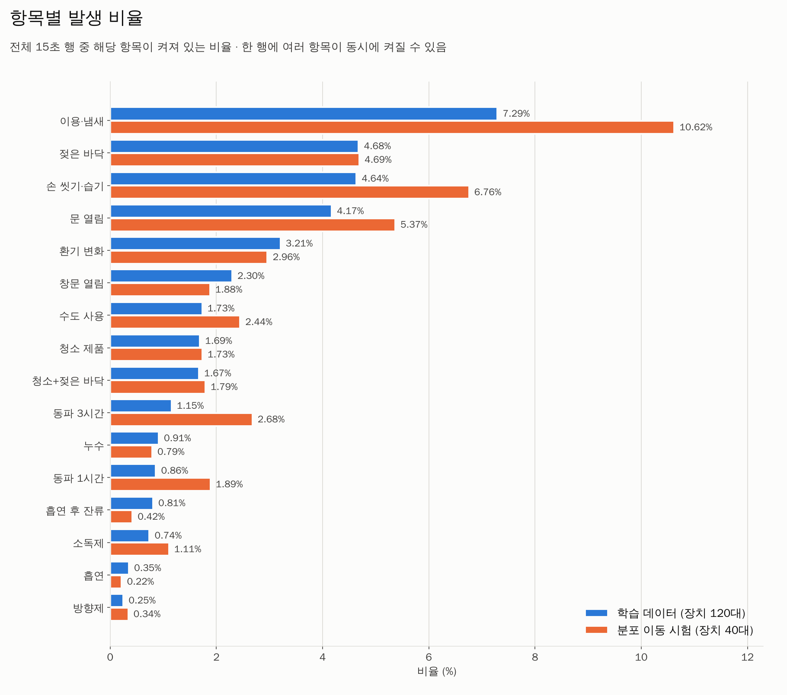
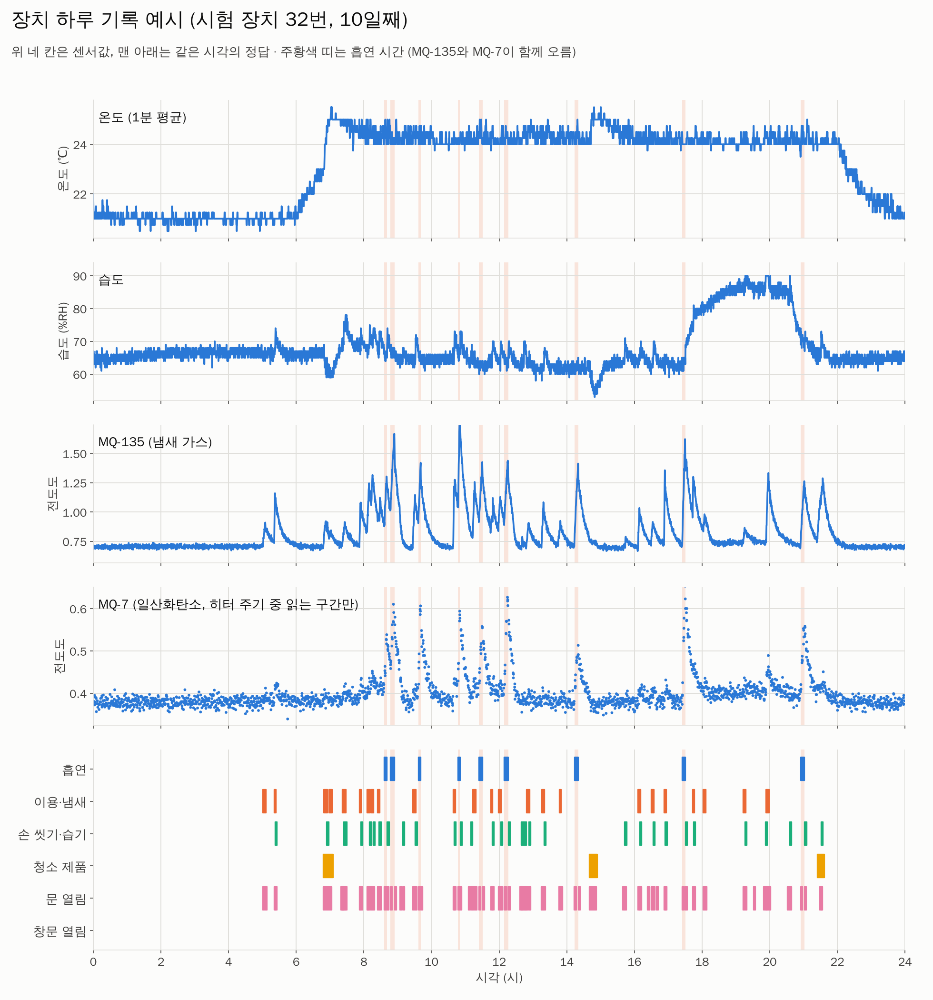
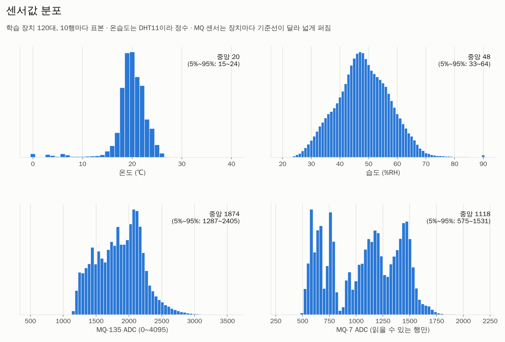
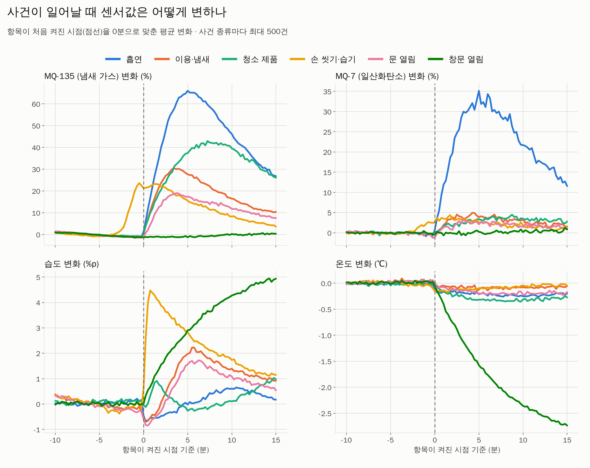
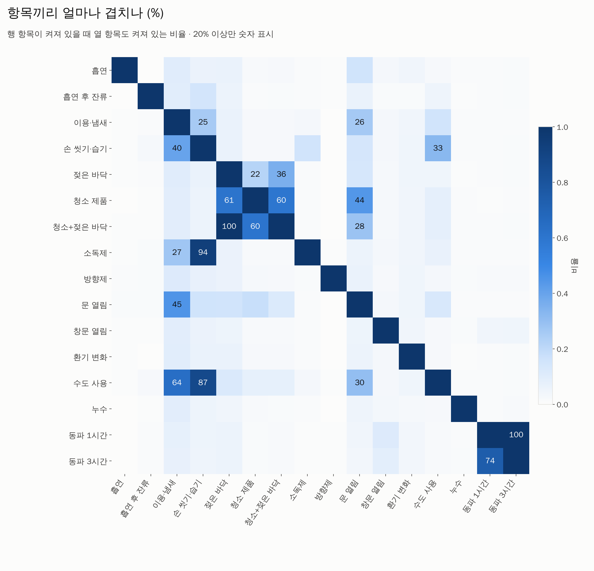
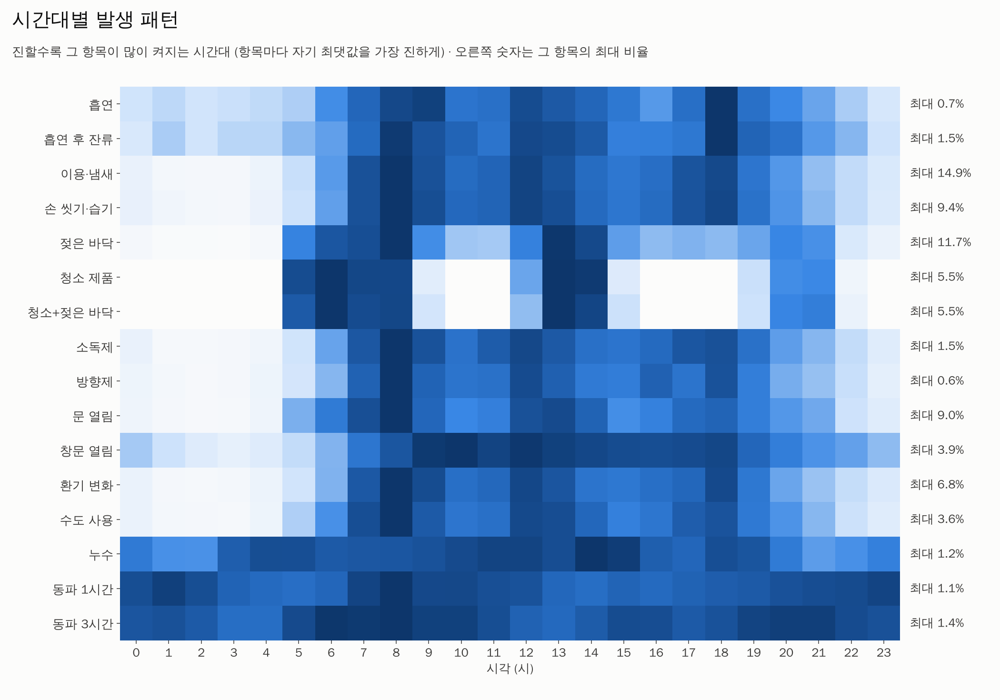
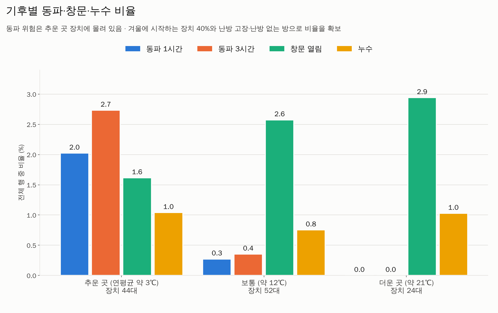

# 통합 학습 데이터 (unified_world_v1)

화장실 센서 상자 하나(DHT11 온습도 + MQ-135 + MQ-7)로 판정하는 **16개 항목의 정답이 한 기록에 함께 들어 있는** 합성 데이터입니다. 통합 모델(`restroom_unified/`)의 학습·보정·시험에 쓴 데이터 그대로입니다.

> **전부 합성 데이터입니다. 실제 화장실 측정은 0행입니다.** 물리 모형의 숫자는 공학적 가정이며 측정값이 아닙니다.

이 데이터로 학습한 모델은 [`models/unified/`](../../models/unified/), 알고리즘과 튜닝 설명은 [`docs/ALGORITHMS.md`](../../docs/ALGORITHMS.md), 학습 과정은 [`docs/TRAINING.md`](../../docs/TRAINING.md)에 있습니다.

## 왜 새로 만들었나

기존 두 연구의 합성 데이터는 세계가 서로 달라(습도 정수/소수, 창문 사건 유무, MQ-7 채널 유무) 하나의 모델로 학습할 수 없었습니다. 이 데이터는 장치마다 하나의 물리 상태(온도, 습도, 가스 두 종류)를 시뮬레이션하고, 모든 항목의 정답을 같은 시계열에 기록합니다.

## 파일

| 파일 | 내용 | 크기 |
|---|---|---|
| `train.npz` | 학습: 장치 120대 × 14일 = 9,676,800행 | 23.6MB |
| `calibration.npz` | 보정(반복 횟수·임계값·흡연 알림 규칙 선택): 40대 × 14일 | 7.8MB |
| `test.npz` | 시험(학습·보정에 쓰지 않은 장치): 40대 × 14일 | 7.9MB |
| `shift.npz` | 분포 이동 시험(다른 기후·센서 감도·문 위치·연기 약함·이용 많음): 40대 × 14일 | 8.0MB |
| `devices_<구분>.csv` | 장치별 물리 파라미터(기후, 창문·환풍기 유무, 센서 감도, 흡연 빈도 등) | 각 13~39KB |
| `sample_2devices_1day.csv` | 눈으로 볼 수 있는 표본: 시험 장치 2대의 하루(11,520행) | 0.9MB |
| `MANIFEST.json` | 구분별 장치 수·행 수·항목별 비율, 파일 크기와 SHA-256 | |

네 구분의 장치는 서로 겹치지 않습니다(시드 1~4). 같은 데이터는 `restroom_unified.world.generate(seed*1000 + 묶음번호, 20, 14, 프로필)`로 다시 만들 수 있고, 내보낸 파일과 다시 만든 결과가 같음을 확인했습니다(라벨·센서값 전부).

## 열 (15초마다 한 행)

| 열 | 뜻 |
|---|---|
| `temperature` | DHT11 온도(℃, 정수, 0~50. 0℃ 아래는 0으로 읽힘) |
| `humidity` | DHT11 습도(%RH, 정수, 20~90) |
| `mq135_adc` | MQ-135 12비트 ADC(0~4095). 전도도 = `adc / (4095 − adc)` |
| `mq7_adc` | MQ-7 12비트 ADC. **히터 150초 주기 중 읽을 수 있는 구간(마지막 60초)에서만 값이 있고, 나머지는 비어 있음**(npz에서는 0) |
| 항목 16개 | 0/1 정답 (아래 표) |

npz에서는 항목이 `labels`(uint16) 비트 마스크 하나로 들어 있습니다(`label_names`의 j번째가 j번째 비트). `restroom_unified/load_dataset.py`가 DataFrame으로 풀어 줍니다.

```python
from restroom_unified.load_dataset import load_split, device_frame
split = load_split("data/unified_world_v1/test.npz")
frame = device_frame(split, 0)       # timestamp, 센서 4열, 항목 16열
```

## 항목 정의 (정답이 1인 때)

| 항목 | 정의 |
|---|---|
| `smoking` | 궐련 흡연 중(2~10분) |
| `smoke_residual` | 흡연이 끝난 뒤 연기 추적 농도가 기준(0.15) 이상 남은 동안 |
| `occupancy_odor` | 냄새가 나는 이용(1~5분) 동안과 끝난 뒤 90초 |
| `handwashing_humidity` | 손 씻기 시작부터 끝난 뒤 2분 |
| `wet_floor` | 젖은 바닥(물을 흘림 15~45분, 또는 물청소 뒤 10~25분) |
| `cleaning_products` | 청소 제품 사용 중(5~15분)과 끝난 뒤 2분 |
| `cleaning_wet_floor` | 물청소 중(60%)과 끝난 뒤 10분 |
| `sanitizer` | 손 소독제 사용 후 2분 |
| `fragrance` | 방향제 분사 후 3분 (40% 장치에만 있음) |
| `door_open` | 15초 안에 문이 한 번이라도 열려 있음 (출입 펄스 8~30초, 청소 중 절반은 고정, 장시간 열림 10~60분 포함) |
| `window_open` | 창문 열림 (창문 있는 장치 65%, 5분~6시간, 가끔 3~9시간 방치) |
| `ventilation_change` | 환풍기 강풍 모드(10~40분) |
| `faucet_on` | 수도가 흐르는 동안(손 씻기, 물 받기 등. 누수 제외) |
| `leak_active` | 지속 누수(20분~5시간) |
| `freeze_risk_1h` | **지금부터 1시간 안에** 실제 실내 온도가 2℃ 이하가 됨(지금 이미 2℃ 이하인 경우 포함) |
| `freeze_risk_3h` | 같은 기준, 3시간 |

한 행에 여러 항목이 동시에 1일 수 있습니다(예: 청소 중 문이 열려 있고 바닥이 젖음).

## 항목 비율 (전체 행 중)

| 항목 | train | calibration | test | shift |
|---|---|---|---|---|
| smoking | 0.35% | 0.39% | 0.45% | 0.22% |
| smoke_residual | 0.81% | 0.82% | 1.17% | 0.42% |
| occupancy_odor | 7.29% | 7.08% | 7.35% | 10.62% |
| handwashing_humidity | 4.64% | 4.54% | 4.82% | 6.76% |
| wet_floor | 4.68% | 4.49% | 4.69% | 4.69% |
| cleaning_products | 1.69% | 1.75% | 1.73% | 1.74% |
| cleaning_wet_floor | 1.67% | 1.72% | 1.66% | 1.79% |
| sanitizer | 0.74% | 0.69% | 0.76% | 1.11% |
| fragrance | 0.25% | 0.23% | 0.17% | 0.34% |
| door_open | 4.17% | 4.16% | 4.41% | 5.37% |
| window_open | 2.30% | 3.12% | 1.70% | 1.88% |
| ventilation_change | 3.21% | 3.02% | 2.67% | 2.96% |
| faucet_on | 1.73% | 1.70% | 1.79% | 2.45% |
| leak_active | 0.91% | 1.08% | 0.70% | 0.79% |
| freeze_risk_1h | 0.86% | 0.51% | 0.68% | 1.89% |
| freeze_risk_3h | 1.16% | 0.71% | 0.97% | 2.68% |

## 그래프 (`graphs/`)

`python -m restroom_unified.plot_dataset --data data/unified_world_v1 --out data/unified_world_v1/graphs`로 다시 그릴 수 있습니다.

| 그림 | 내용 |
|---|---|
|  | `01_label_prevalence.png` 항목별 발생 비율(학습 vs 분포 이동 시험) |
|  | `02_one_day_example.png` 시험 장치 하루: 센서 4종과 같은 시각의 정답 |
|  | `03_sensor_distributions.png` 센서값 분포(DHT11 정수·범위 제한, MQ 기준선 차이) |
|  | `04_event_response.png` 사건이 켜질 때 온도·습도·MQ-135·MQ-7이 변하는 모양 |
|  | `05_label_cooccurrence.png` 항목끼리 함께 켜지는 비율 |
|  | `06_hour_of_day.png` 시간대별 발생 패턴 |
|  | `07_climate_breakdown.png` 기후별 동파·창문·누수 비율 |

## 시뮬레이션이 담은 것

- **날씨·계절·난방:** 기후 3종(추움/보통/더움), 연간 기온 변화, 일교차, 며칠 단위 날씨 변동. 겨울 장치 40%, 난방 고장(3~12시간), 난방 없는 방.
- **문:** 문이 열리면 복도와 공기를 교환합니다. 복도의 온도·습도는 방과 다르고(온도 −5~+2℃, 습도 −20~+10%p), 가스도 빨리 빠집니다.
- **창문:** 바깥 공기와 교환. 겨울 장시간 방치는 동파 위험으로 이어집니다.
- **사람:** 이용(냄새·습기), 손 씻기, 소독제, 방향제, 흡연(연기가 센서에 오는 정도는 장치마다 다름), 청소(물청소 여부), 물 쏟음, 수도, 누수.
- **센서:** MQ-135는 냄새 가스 위주, MQ-7은 CO 위주(냄새에는 약하게 반응). 온습도 교차 감도, 느린 드리프트, 잡음, DHT11 정수 양자화·범위 제한, MQ-7 히터 주기.

## 한계

- 합성 데이터이므로 성능은 이 세계에서의 값입니다. 실제 화장실의 냄새·청소제가 MQ-7을 얼마나 올리는지, 문이 온습도에 얼마나 영향을 주는지는 실측으로 확인해야 합니다.
- DHT11은 0℃ 아래를 읽지 못해(0으로 표시) 영하 구간의 동파는 정답은 있어도 센서값으로는 구분되지 않습니다.
- 전자담배·궐련형 전자담배는 만들지 않았습니다(CO가 거의 없어 MQ-7이 반응하지 않음).
- 앞쪽 2시간(480행)과 뒤쪽 3시간(720행)은 학습·평가에서 뺍니다(예열, 동파 미래 정답 없음).
